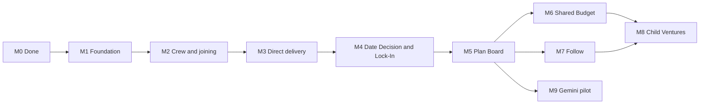

# ORIVOIR implementation plan · MVP v1.0

**Draft 0.2 · November 23, 2026 · for the [living PRD v0.23](prd.md) and its [46 MVP user stories](user-stories.md)**

This plan turns the PRD into an ordered build. Every user story is assigned to exactly one milestone, every milestone lists what it depends on, and every decision the PRD leaves open is named with a recommendation and the milestone it blocks.

- **The PRD wins.** If this plan and the PRD disagree, the PRD is right, and this plan is corrected in the same change.
- **A story is done** when every bullet under it in [user stories](user-stories.md) passes and at least one automated check named with the story ID covers each bullet. Real-device checks are listed where automation can't reach.
- **Nothing here starts until the decisions marked as blocking a milestone are made** (section 4).

## 1. Baseline

Measured on `main` at `4f297fc`:

- **What exists:**
  - a single-user planner that saves to the browser, with optional private GitHub Gist sync
  - the four-step creation wizard
  - the original ATLAS planning tabs: Shape it, When & how long, Explore, Itinerary
  - the budget engine
  - the Budget pill and Budget view
  - 82 unit tests and 4 browser flows
- **What doesn't exist:** a backend, accounts, invitations, Crew, voting, a Plan Board, or Viewers. The stack is Vite, React, TypeScript and hand-written WILDSTROM CSS. Tailwind, Supabase and a map library are not in the code yet.
- **Stories already done:** [LAUNCH-01](user-stories.md#launch-01) and [BUDGET-01](user-stories.md#budget-01).

## 2. The plan at a glance

| Milestone | Goal | Stories it closes | Needs | Size |
| --- | --- | --- | --- | --- |
| **M0** · Done | Homepage entry and budget target | LAUNCH-01, BUDGET-01 | — | — |
| **M1** · Foundation | Domain and routes, Supabase, Planner sign-in, Ventures in the cloud | none (enables everything) | D1, D2, D3, D9, D10 | L |
| **M2** · Crew and joining | Choose people, personal and group links, account-free answers, capacity, **Who** | LAUNCH-03, LAUNCH-04, LAUNCH-06, CREW-01, CREW-02, CREW-04, CREW-05, CREW-07, CREW-09 | M1, D5, D12 | XL |
| **M3** · Direct delivery | One tap sends each person their own email or text; retries and receipts | LAUNCH-05, CREW-08 | M2, D3, D4, D14 | L |
| **M4** · Date Decision and Lock-In | Partial availability, overlap heatmap, cutoff, **Lock this time**, RSVP | CREW-06, DATE-01, DATE-02, DATE-03, DATE-04 | M3, D6, D7 | L |
| **M5** · Plan Board | Decisions, Venture brief, ideas, 👍 support, lock to itinerary, map pin, booking click-out, Collaborators | LAUNCH-02, CREW-03, BOARD-01–08, FLOW-02 | M4, D8, D11 | XL |
| **M6** · Shared Budget | Running cost, confirmed vs. estimated, quantities, scope, average | BUDGET-02, BUDGET-03, BUDGET-04, BUDGET-06, FLOW-01 | M5 | M |
| **M7** · Follow | **Request to follow**, approval, **Following**, redacted reads | VIEW-01–03 | M5 | M |
| **M8** · Child Ventures | Side plans for part of the Crew, linked itinerary and cost | CHILD-01–03, BUDGET-05, FLOW-03, CREW-10 | M6, M7 | M |
| **M9** · Gemini pilot | Private AI dinner ideas inside the Plan Board | PILOT-01–03 | M5, D13 | M |

The size labels are relative (S, M, L, XL) and are not time estimates. Each milestone ships as several small pull requests, each one verified and deployable.

**Releases**

| Release | Milestones | What a group can do | Pilot measure |
| --- | --- | --- | --- |
| **R1 · Gather and pick a date** | M1–M4 | Invite people by email, text or link; collect availability; lock a date; RSVP | Share of invitees who vote through their link (target 55%) |
| **R2 · Plan together** | M5–M6 | Suggest and decide where to eat and stay; see the shared budget | Planners who start another Venture within 45 days (target 35%). Also reported: how often a locked option’s booking link is opened, read alongside **Booked** marks ([BOARD-07](user-stories.md#board-07); evidence for D17). |
| **R3 · MVP v1.0 complete** | M7–M9 | Followers, side plans, AI dinner ideas | Completed Shared Ventures per Active Household |

**Why this order:**
- M1–M4 follow the build order in [Crew invitations](crew-invitations.md) and [Venture launch](venture-launch.md).
- The Plan Board comes before Follow because Viewers need a plan to read, and the redaction rules depend on Plan Board data such as lodging addresses.
- Child Ventures come late because they need the Plan Board, the shared budget and membership rules.
- The Gemini pilot is optional and stands alone once the Plan Board exists.

## 3. Story traceability

Every one of the 46 MVP stories appears here exactly once. The three PAID stories after MVP v1.0 are listed separately below the table.

| Story | Milestone | What remains |
| --- | --- | --- |
| [LAUNCH-01](user-stories.md#launch-01) | M0 | Done |
| [LAUNCH-02](user-stories.md#launch-02) | M5 | A fixed-date launch opens the Plan Board in **planning**. The RSVP card itself ships in M2. |
| [LAUNCH-03](user-stories.md#launch-03) | M2 | Open the working board in **voting** with Review dates; the personal and group cards ask for availability |
| [LAUNCH-04](user-stories.md#launch-04) | M2 | **Max crew opt-ins**, kept separate from the planning headcount |
| [LAUNCH-05](user-stories.md#launch-05) | M3 | **Launch & invite N**; the draft survives sign-in; a retried launch returns the same Venture |
| [LAUNCH-06](user-stories.md#launch-06) | M2 | Contact picker, manual entry, one invitation per recipient |
| [CREW-01](user-stories.md#crew-01) | M2 | Group link landing and account-free joining |
| [CREW-02](user-stories.md#crew-02) | M2 | **Responding as [name]**, **Manage my response**, same-name members |
| [CREW-03](user-stories.md#crew-03) | M5 | Attendee to Collaborator linking. It closes when Collaborator actions exist. |
| [CREW-04](user-stories.md#crew-04) | M2 | Atomic last-spot join; **This Venture has departed** |
| [CREW-05](user-stories.md#crew-05) | M2 | **Who** view, **5 of 6 spots filled**, **Remove from Crew**, raising the limit |
| [CREW-06](user-stories.md#crew-06) | M4 | **I can join for part**; several windows in one submission |
| [CREW-07](user-stories.md#crew-07) | M2 | Personal link answers with no name, code or app. Delivered by **Share personal invite** in M2 and by ORIVOIR in M3. |
| [CREW-08](user-stories.md#crew-08) | M3 | One-tap delivery, readiness review, retry only failures |
| [CREW-09](user-stories.md#crew-09) | M2 | **Mom · Saturday works**; private contact details; separate statuses |
| [DATE-01](user-stories.md#date-01) | M4 | Response pills, countdown, two-layer heatmap, whole and partial counts |
| [DATE-02](user-stories.md#date-02) | M4 | Server cutoff, move the cutoff, revise options |
| [DATE-03](user-stories.md#date-03) | M4 | **Lock this time**, **Send date to N**, early lock |
| [DATE-04](user-stories.md#date-04) | M4 | **Count me in** / **Can't make it**; **Text me when [Planner] picks a date** |
| [VIEW-01](user-stories.md#view-01) | M7 | **Request to follow** from the departure screen, a group link and private email |
| [VIEW-02](user-stories.md#view-02) | M7 | Approve, decline, revoke |
| [VIEW-03](user-stories.md#view-03) | M7 | **My Ventures → Following**; redacted, read-only plan |
| [BOARD-01](user-stories.md#board-01) | M5 | Expandable days, decision cards, **Whole Venture**, starters on an empty board, must-dos as decisions |
| [BOARD-02](user-stories.md#board-02) | M5 | **Add Idea** form: manual entry, link, or provider JSON; carousel |
| [BOARD-03](user-stories.md#board-03) | M5 | Inherited dates and limits; OpenTable links |
| [BOARD-04](user-stories.md#board-04) | M5 | 👍 support, including Attendees with no account |
| [BOARD-05](user-stories.md#board-05) | M5 | **Lock this option**, **Locked in**, itinerary updates instantly |
| [BOARD-06](user-stories.md#board-06) | M5 | Exact time / window / **Time TBD**, location with **Open in Maps**, map pin on **Show map**, **Drop a pin** before any geocoder, **Booked** with one reminder |
| [BOARD-07](user-stories.md#board-07) | M5 | Open a locked option’s provider page; record the D15 click-out event and change nothing else |
| [BOARD-08](user-stories.md#board-08) | M5 | Venture brief the Planner edits and the crew sees; kept from Viewers and every message; print shows the feel line; imported answers as a Planner-only draft |
| [BUDGET-01](user-stories.md#budget-01) | M0 | Done. The server moves in M1 and is regression-tested there. |
| [BUDGET-02](user-stories.md#budget-02) | M6 | Price and basis on cards; **Adds $120 to the plan** |
| [BUDGET-03](user-stories.md#budget-03) | M6 | Quantity override; **4 tickets confirmed** and the gap. The first bullet shipped in #31. |
| [BUDGET-04](user-stories.md#budget-04) | M6 | Confirmed replaces estimate once; **Cost TBD**; **Free**; over target |
| [BUDGET-05](user-stories.md#budget-05) | M8 | Scope and average per person in M6. Linked child costs close it in M8. |
| [BUDGET-06](user-stories.md#budget-06) | M6 | **All selected costs confirmed** |
| [CHILD-01](user-stories.md#child-01) | M8 | Start a child Venture as a Collaborator |
| [CHILD-02](user-stories.md#child-02) | M8 | Invite a subgroup; separate RSVPs |
| [CHILD-03](user-stories.md#child-03) | M8 | Approved summary on the main itinerary; changes flow through |
| [PILOT-01](user-stories.md#pilot-01) | M9 | Planner key, per-Venture Collaborator access, limit, usage |
| [PILOT-02](user-stories.md#pilot-02) | M9 | **Find dinner ideas**; privacy-filtered context; schema-validated drafts |
| [PILOT-03](user-stories.md#pilot-03) | M9 | **Suggest to crew**; failures create no cards |
| [FLOW-01](user-stories.md#flow-01) | M6 | Compare alternatives, lock a date in either order, retain ideas and count only selected costs. |
| [FLOW-02](user-stories.md#flow-02) | M5 | Verify duration first, Planner override and completed responses. |
| [FLOW-03](user-stories.md#flow-03) | M8 | Cancel and retry account linking with one draft, member and posted idea. |
| [CREW-10](user-stories.md#crew-10) | M8 | Test subgroup isolation, withdrawn consent, deduplication and fresh RSVP. |

**After MVP v1.0, gated by D17.** These stories aren't scheduled and aren't counted in the 46.

| Story | Milestone | What remains |
| --- | --- | --- |
| [PAID-01](user-stories.md#paid-01) | None (D17) | Placement only on lodging and activity booking links; the **Paid link** label on cards and the print one-sheet; click-ID-only tracking; partners named in the privacy policy |
| [PAID-02](user-stories.md#paid-02) | None (D17) | Order, support, locked choice, budget, search buttons and Gemini drafts unchanged by commission |
| [PAID-03](user-stories.md#paid-03) | None (D17, D19) | Pasted links never rewritten; paid links only on links ORIVOIR builds |

**PRD MVP acceptance checks** ([PRD](prd.md#mvp-acceptance-checks)) and where each one first passes:

| Check (short) | Milestone |
| --- | --- |
| $150 per person survives a headcount change | M0 (done) |
| **Start a Venture** opens **Set the Scene** | M0 (done) |
| Wizard order; **Launch Venture** vs. **Launch & invite 6** | M3 |
| Signed-out Planner chooses contacts, signs in, returns to the same draft | M3 |
| Six mixed SMS/email invites, one failure retried, replays deduplicated | M3 |
| Personal invite identifies the person; group card has only the group URL; previews take nothing | M2 (re-verified over SMS/email in M3) |
| Two same-name members; same-browser restore; manage link on another device | M2 |
| Attendee availability, RSVP and 👍 without an account; Collaborator-only ideas and child Ventures; account linking keeps everything | M5 (child part in M8) |
| Two simultaneous submissions for the last spot admit exactly one | M2 |
| Remove from Crew; raising the limit frees capacity | M2 |
| Stale tab after cutoff or early lock; extending the cutoff reopens voting | M4 |
| Zero, partial or tied replies leave the date pending until locked | M4 |
| June 11–13: **4 for the whole weekend · 1 for Saturday only** | M4 |
| RSVP on the same link; availability leaves attendance pending | M4 |
| Fixed-date launch and Lock-In produce the same card; resend and group share rules | M4 |
| Venture brief reaches the crew, never Viewers or messages; imported answers stay a Planner-only draft | M5 (Viewer part re-verified in M7) |
| Viewer email preview takes nothing; one tap shows **Request sent** | M7 |
| Group-link follow, signed in and signed out; approval; revocation | M7 |
| Viewers can't change anything or see redacted fields | M7 |

## 4. Decisions needed

These are the decisions only Dot can make, with Claude's recommendation for each. The ones that block M1 come first.

| # | Decision | Recommendation | Blocks |
| --- | --- | --- | --- |
| D1 | **Domain and hosting.** Personal and group invite links need path URLs (`/i/:token`, `/invite/:token`) on HTTPS. Message previews also need per-Venture card metadata served before the React app loads, which GitHub Pages can't do. | **Decided November 21, 2026:** `orivoir.com` (registered at GoDaddy), hosted on Cloudflare. Cloudflare serves the app's static files free at any traffic level, and a Worker serves the invite previews. DNS moves to Cloudflare's nameservers; GoDaddy stays the registrar. Move to Workers Paid ($5 per month) before the first real invitation, so preview requests are never refused at the free limit. Keep GitHub Pages until the move. | M1 |
| D2 | **Supabase plan and environments** | Free projects for development and staging during M1–M2. Production on the Pro plan ($25 per month per organization) before the first real invitation, because free projects pause after a week of inactivity, which would break live invite links. Tests run against a local Supabase in CI. | M1 |
| D3 | **Email provider** for sign-in codes and invitations | One transactional provider for both: SMTP for Supabase Auth, its API for invitations. Supabase's built-in email is for testing only and sends only to the project team's addresses. Choose one that supports a verified sending domain (SPF, DKIM, DMARC). | M1 (sign-in for anyone but Dot), M3 |
| D4 | **SMS route and sending identity** | Start carrier registration during M1 so texting can be ready by M3. New toll-free number registrations need a business registration number such as an EIN, an unverified toll-free number can't text US phones, and approval takes days to weeks. Decide whether ORIVOIR sends under a registered business. Until texting is approved, R1 uses email plus **Share personal invite** (the Planner sends the link from their own phone), which the PRD allows. | M3 (texting only) |
| D5 | **Candidate windows** (PRD *Remaining ideation*) | ORIVOIR proposes windows from the range and ideal length, and the Planner edits them in **Schedule** before launch. **Weekend** gives each Friday–Sunday in the range. "N nights" gives windows starting each Friday and Saturday. A single evening gives each date in the range. Cap the list at about 8 windows. No partial availability inside a single evening in MVP. The existing cost-ranking engine in When & how long can become an optional Planner helper. | M2 |
| D6 | **Attendance after lock and guest visibility** (PRD *Remaining ideation*) | MVP has one RSVP for the whole Venture. Days a person offered stay visible to the Planner as context. Partial-day attendance is deferred. Opted-in Crew members see the full Plan Board and itinerary, minus the Planner's private contact data. Viewers get the redacted plan (M7). | M4 |
| D7 | **Changing a locked date** (PRD *Remaining ideation*) | The Planner can change a locked date. Memberships and availability are kept, every RSVP resets to pending, and **Send date to N** offers the new date with "date changed" wording. Child Ventures follow the existing CHILD-03 review rule. | M4 |
| D8 | **What happens to the original single-user tabs** | **Revised November 23, 2026.** The Plan Board is the only planning view. A Venture opens to the Plan Board in either schedule mode; Review dates opens Date Decision, and the numbered tabs retire. Explore and Itinerary become the Plan Board: options become ideas, **Choose** becomes **Lock this option**, and the itinerary is built from locked options. When & how long becomes an optional Planner helper inside Date Decision (D5). **Shape it retires:** its feel, avoid and notes answers become the [Venture brief](user-stories.md#board-08), which the Planner edits and the whole crew sees; must-dos become decision cards; lodging and food become starter decisions ([BOARD-01](user-stories.md#board-01)); pace, bases, transport and season are dropped. The kids question and children's ages were removed on November 22. Travel legs stay Planner-only until the Transit ideation. The copy-and-paste research helper is replaced by **Add Idea** with provider JSON and by the Gemini pilot. Keep the print one-sheet; it shows the brief's feel line where it showed *The idea*. | M5 |
| D9 | **Ventures already saved in browsers, and Gist sync** | Launching requires sign-in, as the PRD says. On first sign-in, offer to import the Ventures saved in this browser; nothing is imported without the Planner confirming. After import, the cloud is the source of truth. Gist sync becomes export-only, then is removed after R1. Keep the JSON backup. Private contact data never goes to the Gist. | M1 |
| D10 | **Venture time zone** | Default to the Planner's device time zone, editable under Set the Scene. Store it as an IANA name, with all instants as time-zone-aware timestamps (PRD *Routing and data*). | M1 |
| D11 | **Maps and coordinates** | **Decided November 22, 2026.** (1) **Library:** MapLibre GL JS (BSD-3), the open-source fork of Mapbox GL JS. No Mapbox account or token. (2) **Map images (tiles):** start with the OpenFreeMap public instance (free, no API key, no stated limits). Plan a later move to self-hosted Protomaps PMTiles on Cloudflare R2, served through the Protomaps Worker with edge caching, if OpenFreeMap has reliability problems or new limits, or a custom style is needed. The style URL is one config value behind a single `MapView` component, so the move is a config change. (3) **When a map loads:** never by default. A location shows as text with an **Open in Maps** link built from Google Maps URLs (no API key). **Show map** loads MapLibre with a dynamic import and draws the pin; **Drop a pin** loads it the same way so the Planner can place or confirm a pin. No maps on invite cards, group cards, link previews, emails or texts. The print one-sheet shows the address and the Maps link, with no map image in MVP v1.0. (4) **Coordinates, in this order:** (a) from the provider's link or JSON when present; (b) a pin the Planner drops or confirms; (c) only then a geocoder called from an Edge Function, Geoapify's free tier. Store `lat`, `lng` and `coords_source` (`provider`, `planner_pin` or `geocoder`) on the option. No Mapbox geocoding: storing its results requires its paid permanent tier. (5) **Attribution:** MapLibre's attribution control stays on, so "© OpenStreetMap contributors" shows on every map, plus the credit Geoapify's free tier requires. (6) **Privacy:** coordinates count as the address. Wherever a home address is redacted (Viewers, previews, AI inputs), its coordinates are too, and no map shows. Place text goes to the geocoder only from the Edge Function, never with names or contact details. Tile requests show the tile host roughly which area is being viewed; OpenFreeMap sets no cookies and keeps no user database, and self-hosting removes that third party. Geoapify and the tile host are listed in the privacy policy (D14). | M5 |
| D12 | **Visual and stack wording in the PRD** | **Decided November 22, 2026.** The PRD now matches the code: WILDSTROM CSS with no Tailwind, and gold primary actions in the Storm theme (`#dfb84b`, used since Nov 19). Daylight's accent values stay as the [design system](design-system.md) records them. | M2 (new UI) |
| D13 | **Gemini pilot scope and key storage** | Keep it in MVP v1.0 as the last milestone. Store the Planner's key encrypted server-side (Supabase Vault). Only an Edge Function reads it. | M9 |
| D14 | **Privacy policy and terms** | Needed before invitations go to people outside the household. SMS registration requires public privacy and opt-in disclosures. Claude can draft them for Dot's review; they are not legal advice. The policy lists Geoapify and the map tile host (D11). Once paid links are on (D17), the policy must name every commission partner (PRD [Paid booking links](prd.md#paid-booking-links), rule 4). | M3, R1 |
| D15 | **Pilot measurement** | A first-party event table in Supabase, with no third-party analytics. Events carry IDs and timestamps only: no names, contact details or Planner address-book data. The booking click-out event ([BOARD-07](user-stories.md#board-07)) carries only the option ID, decision kind, member or account ID and timestamp. | R1 |
| D16 | **Order after R1** | M5 → M6 → M7 → M8 → M9, as above. Confirm or reorder. | M5 |
| D17 | **When to turn on paid links** (PRD [Paid booking links](prd.md#paid-booking-links)) | After the R2 pilot shows people opening booking links from locked options (the [BOARD-07](user-stories.md#board-07) click-out, read alongside **Booked** marks). Dot sets the threshold. Until then paid links stay off, and [PAID-01](user-stories.md#paid-01) to [PAID-03](user-stories.md#paid-03) stay unscheduled. Programs such as Tripadvisor's pay nothing on the account holder's own click-outs, so Dot's own household bookings won't earn. | PAID-01–03 (after MVP v1.0) |
| D18 | **Route:** direct programs (Booking.com via CJ, Expedia Group including Vrbo, Viator) or an aggregator such as Stay22 | Start with one aggregator to cut integration and approval work. The trade-off is a smaller share and one more dependency: when Airbnb closed its affiliate program in March 2021, Stay22 lost 80% of its booking inventory. Airbnb has no program today, so Airbnb stays never pay. Commission is paid only after the stay or experience, and some programs exclude multi-room group bookings, so check each program's terms. Current published rates are under *Sources checked*. | After D17 |
| D19 | **Links people paste** | Never rewrite a link a Planner or Collaborator pasted. Paid links appear only where ORIVOIR builds the link itself, such as a **Find stays** button on a lodging decision ([PAID-03](user-stories.md#paid-03)). | After D17 |
| D20 | **Payee** | Programs pay a business. Decide it with D4 (EIN and registered business), and apply to programs in that business's name. | After D17; ties to D4 |

### Decisions made

| Date | Decision | Outcome |
| --- | --- | --- |
| November 21, 2026 | D1 | Domain `orivoir.com`, registered at GoDaddy. Host: Cloudflare, chosen over Vercel, Amazon CloudFront, Netlify, Firebase Hosting, Azure Static Web Apps and Render because serving the app's files costs nothing at any traffic level, so a surge of visitors can't produce a hosting bill. DNS moves to Cloudflare's nameservers; GoDaddy stays the registrar. Workers Paid ($5 per month) before the first real invitation. |
| November 21, 2026 | D2 | Free Supabase projects for development and staging. Production moves to Pro before the first real invitation. |
| November 21, 2026 | D3 | Open. Claude compares current pricing and deliverability for two or three providers; Dot chooses. |
| November 21, 2026 | D9, D10 | The recommended defaults stand unless Dot objects: an import offer on first sign-in, which needs her confirmation, and a time zone that defaults to the Planner's device. |
| November 21, 2026 | Revenue path | Commission from booking sites through paid links, under the placement, disclosure, ranking, privacy and measurement rules in PRD [Paid booking links](prd.md#paid-booking-links). The consumer core stays free. Click-out measurement ships in M5. Turning paid links on waits for D17, with D18–D20 open. |
| November 22, 2026 | D11 | Replaced the earlier Mapbox plan (a Mapbox account and token, with Mapbox geocoding) with MapLibre GL JS and OpenFreeMap tiles, moving later to Protomaps on Cloudflare R2 if needed. Maps load only on **Show map**. Coordinates come from the provider or a Planner pin before the Geoapify geocoder, and coordinates follow address redaction. The goal is a map setup that costs close to nothing at any scale. |
| November 22, 2026 | D8 | Dot found Shape it and the Plan Board duplicated each other. Shape it retires and the Plan Board is the only planning view. Its answers become a Venture brief that the whole crew sees (Dot's choice over Planner-only notes), with must-dos as decision cards and starter decisions on an empty board. Separately, a hotfix removed the kids question and stopped collecting children's ages. |
| November 22, 2026 | D12 | Dot chose to update the PRD to the code as built: WILDSTROM CSS, no Tailwind, and the gold Storm accent instead of "lime primary actions" (PRD v0.21). |

## 5. Architecture

### 5.1 Routes and hosting

| Surface | Route | Notes |
| --- | --- | --- |
| Home, wizard, Venture workspace | `/`, `/new`, `/ventures/:id/...` | Path routes replace today's hash routes after D1. Old `#/trip/...` links redirect. |
| Date Decision | `/ventures/:id/dates` | Planner |
| Plan Board | `/ventures/:id/plan` | Planner and Collaborators by account; Attendees by private access; Viewers redacted |
| Budget view | `/ventures/:id/budget` | Planner edits; Crew reads the rollup (M6) |
| Group invite | `/invite/:token` | Public card metadata, then the join page |
| Personal invite | `/i/:token` | Public card metadata, then the answer page; no side effects on open or preview |
| Manage my response | `/me/:token` | Private member link |
| Following | `/my-ventures/following` | Signed-in Viewers |

A Cloudflare Worker (D1) serves `/i/:token` and `/invite/:token` with only the preview-approved card fields (title, dates, Planner first name, generic image). Only these two routes run the Worker; every other request is served as a static file. The Worker never includes a phone number, private avatar, response or token in the metadata or image URLs ([Crew invitations](crew-invitations.md)). Link-only SMS and thumbnail clients are both tested.

### 5.2 Supabase

- **Projects:** `orivoir-dev` and `orivoir-staging` (free), and `orivoir-prod` (Pro, per D2).
- **Code in the repo:**
  - schema and policies as migrations in `supabase/migrations/`
  - Edge Functions in `supabase/functions/`
  - seed data for tests
- **Secrets:** stay in Supabase Edge Function secrets and the hosting provider's environment. Never in the repo, the client bundle or this chat. The Vite client gets only the project URL and the public anon key.
- **Auth:** email one-time code for Planners, Collaborators and Viewers, through the D3 provider. The Viewer's private **Request to follow** link is a separate, single-use, expiring token issued by an Edge Function, not a reusable sign-in link.

### 5.3 Data model

These responsibilities come from [PRD *Routing and data*](prd.md#routing-and-data) and [Crew invitations](crew-invitations.md#server-and-data-contract). Names are proposals.

| Table | Key fields | Rules |
| --- | --- | --- |
| `ventures` | Planner, title, destination, region, `time_zone`, `schedule_mode` (fixed or decision), `status` (voting or planning), fixed or locked schedule, `opt_in_by`, target window, ideal length, `max_opt_ins`, planning headcount, budget amount, currency and basis, cushion, `parent_venture_id`, `legacy_local_id`, brief (`brief_feel`, `brief_avoid`, `brief_notes`, `brief_shared`) | One nesting level. `legacy_local_id` makes the browser import idempotent. |
| `candidate_windows` | Venture, stable slot key, start and end dates and times, revision | Revising windows bumps the revision and prompts fresh answers (DATE-02) |
| `invitations` | Venture, issuer, private recipient label, private avatar reference, channel, destination, normalized `destination_key`, state (pending, claimed, revoked), membership | One intended invitation per recipient per Venture, unique on (Venture, `destination_key`). Planner-only. |
| `memberships` | Venture, account (required for Collaborators), role, shared display name and photo choice, status (active, removed), `opted_in_at` | One active membership per claimed invitation. Removal revokes access. |
| `private_access` | Token digest, purpose (invitation, member, viewer-follow), scope, expiry, revoked or used time | Tokens are high-entropy and only digests are stored. Viewer-follow tokens are single-use. |
| `availability` | Membership (one current), submitted time, `none_work`, selections per window (whole, or specific dates) | A missing row means pending. An empty submission means **None of these work**. |
| `attendance` | Membership (one current), schedule version, going or not going | Separate from availability |
| `send_operations`, `deliveries` | Operation key, purpose, schedule version; per delivery: channel, status (queued, accepted, delivered, failed, uncertain), attempts, provider message ID | Unique operation key and provider message ID make launches and callbacks replay-safe |
| `messaging_permissions` | Destination, channel, sender, purpose, source and time, withdrawal or suppression | Checked again at dispatch |
| `follower_access` | Venture, account, status (pending, approved, declined, revoked) | Unique per (Venture, account) |
| `decisions`, `options`, `supports` | Day or Whole Venture, title, kind (general or stay), window, limit; option title, place, address, coordinates (`lat`, `lng`, `coords_source`: `provider`, `planner_pin` or `geocoder`; D11), source, proposed time, estimate (amount, currency, basis, quantity), cost state, confirmed amount and quantity, included, booked, private draft; support per member | One support row per (option, member). One locked option per decision. |
| `child_links` | Child Venture, main Venture, status (requested, approved), linked cost | Updates flow from the child |
| `ai_connections`, `ai_requests` | Planner, encrypted key reference, per-Venture Collaborator access, limit, usage | Requests log counts and outcomes, never prompt text containing personal data |
| `events` | Event name, Venture ID, member or account ID, timestamp | For D15 only. No names or contact details. The booking click-out event (BOARD-07) records only the option ID, decision kind, member or account ID and timestamp. |

**Budget rule on the server.** The client's `withBudgetTotal` won't run on server-side writes. The PRD says a group estimate is "derived when needed … without overwriting the saved entry", so the database stores the entry (amount, currency, basis) and computes the group target when it's read, in a view or function. It doesn't store the derived total. The same applies to estimates that use the default quantity (M6).

### 5.4 Access model

- **Planners and Collaborators** use Supabase Auth and row-level security on every table. A Planner owns their Ventures. A Collaborator acts through an active membership tied to their account.
- **Attendees** never get direct table access. Every guest action goes through a small set of database functions that take a private token or group token:
  - open the card (read only)
  - submit availability
  - RSVP
  - support an option
  - attach a personal invitation to an existing entry

  Each function checks the token's scope, the Venture's phase, the cutoff and capacity, and writes in one transaction, locking the Venture row so two people can't take the last spot.
- **Viewers** read through a redacted projection. Home addresses and their coordinates, minors' details, the Venture brief, invitations, contact data and tokens never leave the database for them.
- **Venture brief:** the Planner writes it. Collaborators read it through membership and Attendees through the card function. While `brief_shared` is false (an imported draft), only the Planner reads it.
- **Edge Functions:**
  - the delivery worker and provider callbacks (signature-verified)
  - invite preview metadata, on the host
  - the Viewer follow action
  - geocoding fallback (Geoapify), only when the provider gave no coordinates and the Planner set no pin
  - the Gemini proxy
- **Realtime** pushes Crew changes to the Planner. Guests reload state when they open a link, and a stale submission shows the current phase.

### 5.5 Moving off browser storage

M1 keeps today's local mode working for already-saved Ventures until the Planner imports them (D9). New Ventures launch only after sign-in. The import maps each local Venture to `ventures` plus its existing budget fields and keeps the original ID in `legacy_local_id`, so running it twice changes nothing. Shape it answers become a draft brief with `brief_shared` false: the purpose answer becomes the feel line, the avoid answer the avoid line, and the notes plus the pace, bases, lodging, transport, must-do, food and season answers become labeled lines in the notes. A kids answer is never imported. The browser copy is kept until the import is confirmed.

## 6. Milestones

### M1 · Foundation

**Goal:** a signed-in Planner can launch and reopen Ventures from the cloud on any device, on the new domain.

- **Build:**
  - the domain and host move; path routing with redirects from old hash links
  - Supabase projects and migrations for `ventures` and `candidate_windows` (ready for M2)
  - email-code sign-in at launch, with the draft kept through sign-in (no recipients yet)
  - Ventures saved and loaded through Supabase
  - the Venture time zone
  - the browser-import offer
  - Gist sync made export-only
  - CI runs database tests against a local Supabase
- **Moves to the server:**
  - the budget entry and the derived group target (5.3), with BUDGET-01's tests run against the server
  - the existing planning tabs keep working on cloud data
- **Verify:**
  - the existing 82 unit tests and 4 browser flows still pass
  - new browser flows for sign-in with draft restore, launch and reopen on another browser session, and import idempotency
  - row-level security tests showing one Planner can't read another's Venture
- **Needs first:** D1, D2, D3, D9, D10. Start D4 registration and the D14 drafts now; they take calendar time.
- **Risks:**
  - The routing change touches every link. Mitigate with redirects and a link test across all current routes.
  - Email deliverability. Mitigate with a verified sending domain before anyone outside the household signs in.

### M2 · Crew and joining

**Goal:** a Planner gathers people and they answer without accounts. Capacity holds under concurrency.

- **Build:**
  - **Crew step:** **Choose from contacts** where the browser supports it, **Add by phone or email**, one row per person with photo or initials and one destination, edit and remove, and deduplication with same-name safety ([LAUNCH-06](user-stories.md#launch-06)). Plus **Max crew opt-ins** and the planning headcount ([LAUNCH-04](user-stories.md#launch-04)).
  - **Candidate windows:** generated and editable in Schedule (D5), and shown on the invite preview.
  - **At launch:** invitations and the group link. **Share personal invite** and **Share a group link** use the device share sheet, or copy the link where there's no share sheet.
  - **Personal and group landing pages:** **Responding as [name]**, the display-name prompt for group joiners, whole-window availability and **None of these work**, fixed-date RSVP, and **Manage my response**.
  - **Joining:** one atomic join function for both link types. **This Venture has departed** when full or closed (the **Request to follow** button arrives in M7; until then the screen says to ask the Planner).
  - **Who view:** joined members, **N of M spots filled**, named invitations **Awaiting reply**, private contact details on row tap, **Remove from Crew**, raise the limit.
  - **A minimal Date Decision workspace:** status, roster, whole-window counts per window ([LAUNCH-03](user-stories.md#launch-03)).
- **Closes:** LAUNCH-03, LAUNCH-04, LAUNCH-06, CREW-01, CREW-02, CREW-04, CREW-05, CREW-07, CREW-09.
- **Verify:**
  - database race tests: two simultaneous first answers for the last spot admit exactly one
  - replay tests: the same submission twice gives one membership
  - privacy tests: the group card, the shared roster and previews carry no address-book fields or tokens
  - browser flows for two members named Maya, same-browser restore, the manage link in a fresh browser, and remove-then-rejoin
  - real devices: the contact picker on Android Chrome and the manual fallback on iPhone Safari
- **Needs first:** M1, D5, D12.
- **Risks:**
  - The contact picker only exists on some browsers. The manual path is always available, and both are tested.
  - Token leakage. Only digests are stored, tokens are kept out of logs, and the redaction tests are part of CI.

### M3 · Direct delivery

**Goal:** one tap sends each selected person their own email or text, and failures can be retried one by one.

- **Build:**
  - delivery intents created with the launch in one transaction, using a stable operation key
  - the delivery worker, with email and SMS adapters behind one interface and test transports for CI
  - provider idempotency, reconciliation of uncertain results, and signed callbacks that tolerate duplicates and late arrivals
  - a readiness review before sending: **Add email** or **Share personal invite** on rows that can't be sent
  - **Launch & invite N** and **Send N invites**
  - per-person delivery status shown separately from answers; **Retry** for failed recipients only
  - SMS permission records and suppression (STOP)
  - a readable text-and-link fallback for SMS
- **Closes:** LAUNCH-05, CREW-08.
- **Verify:**
  - With test transports: six mixed recipients, one failure, and a retry that sends only that one.
  - A provider timeout after acceptance, a replayed callback, a suppressed number, a late failure, and a double-tapped launch that still creates one Venture.
  - Real email and SMS clients render the card and link.
- **Needs first:** M2, D3 live, D14 published. D4 approval is needed for texts; email can ship without it.
- **Risks:**
  - SMS approval timing. Email and share links carry R1 if approval is late.
  - Spam complaints. Rate limits per Planner and per Venture, and only explicit Planner sends.

### M4 · Date Decision and Lock-In

**Goal:** the Crew says which days work, the Planner locks a time, and everyone RSVPs on the same entry.

- **Build:**
  - **Answering:** **I can join for part** with per-day selection in the Venture time zone, several windows in one submission, and edits while voting is open ([CREW-06](user-stories.md#crew-06)).
  - **Planner's view:** live response pills, the countdown, and the two-layer heatmap with whole and partial counts, highlighting matches to the preferred length ([DATE-01](user-stories.md#date-01)).
  - **Cutoff:** enforced on the server, the cutoff can be moved forward, and windows can be revised with fresh answers requested ([DATE-02](user-stories.md#date-02)).
  - **Locking:** **Lock this time** saves the schedule and switches to planning in one transaction. Then the shared fixed-date card builder (the same output as a fixed-date launch), **Send date to N** to eligible members, and **Share a group link** with the original URL ([DATE-03](user-stories.md#date-03)).
  - **After the lock:** **Count me in** / **Can't make it**, and **Text me when [Planner] picks a date** for group joiners ([DATE-04](user-stories.md#date-04)). Locked dates can be changed under D7.
- **Closes:** CREW-06, DATE-01, DATE-02, DATE-03, DATE-04.
- **Verify:**
  - the PRD June 11–13 example (**4 for the whole weekend · 1 for Saturday only**, then five whole)
  - stale tabs after cutoff and after an early lock
  - card parity between a fixed-date launch and a lock for the same schedule, on each channel
  - unjoined people see the departure screen after the lock
  - a failed or dismissed send leaves the date locked
- **Needs first:** M3, D6, D7.
- **R1 gate:** at the end of M4, run the friends-and-family pilot with the D15 measures in place.

MVP delivery starts with duration-first scheduling and draft access in M2. M5 delivers comparison, the featured Crew question and account linking for suggestions. M6 verifies that only selected-plan costs count. M8 completes account linking for side plans and invitations from Past Crew.

Record alternatives, their relative days, duration and selected plan under one Venture. Keep proposal support separate from date availability and RSVP. Use a membership-scoped consent record for Past Crew, checked both on listing and on sending. Track child membership independently.

### M5 · Plan Board

**Goal:** the Crew suggests, supports and decides, and decisions land on the itinerary.

- **Build:**
  - **Board and decisions:** expandable days in the Venture time zone, **Whole Venture**, decision cards (title required; window, limit and note optional), and **A place to stay** covering several nights ([BOARD-01](user-stories.md#board-01)).
  - **Ideas:** one **Add Idea** form for manual entry, links and provider JSON, mapped to the common option schema, with one carousel per decision ([BOARD-02](user-stories.md#board-02)). Dates and limits are inherited, with OpenTable links for dinner ([BOARD-03](user-stories.md#board-03)).
  - **Support and locking:** 👍 support through accounts or private access ([BOARD-04](user-stories.md#board-04)). **Lock this option**: **Locked in**, the locked option first, the itinerary updated in the same transaction ([BOARD-05](user-stories.md#board-05)).
  - **Itinerary details:** exact time, window or **Time TBD**; the location as text with **Open in Maps**; with coordinates, **Show map** loads MapLibre through a dynamic import in the single `MapView` component and draws the pin; coordinates from the provider, then a pin the Planner drops or confirms with **Drop a pin**, then the geocoding fallback (D11), saved with `coords_source`; **Booked** with one reminder when switching away ([BOARD-06](user-stories.md#board-06)).
  - **Booking click-out:** the Planner, Collaborators and Attendees can open a locked option's source link. Opening it records the D15 click-out event and changes nothing else ([BOARD-07](user-stories.md#board-07)). No paid links (D17).
  - **Venture brief and starters:** the brief at the top of the board, edited by the Planner and readable by the crew; kept out of the Viewer projection and every card, preview and message; the imported draft shown only to the Planner until **Share with crew** ([BOARD-08](user-stories.md#board-08)). Starters on an empty board by Venture length ([BOARD-01](user-stories.md#board-01)).
  - **Collaborators and launch:** Attendee-to-Collaborator linking with a verified account plus the member's private credential ([CREW-03](user-stories.md#crew-03)). Both schedule modes open the Plan Board ([LAUNCH-02](user-stories.md#launch-02)).
  - **Migration:** existing Explore candidates and the itinerary move into decisions and options under D8. Shape it answers imported in M1 appear as the Planner-only draft brief.
- **Closes:** LAUNCH-02, CREW-03, BOARD-01–08, FLOW-02.
- **Verify:**
  - the PRD Saturday Dinner acceptance check (Maya adds a link, Jules supports two options, a lock with no votes, Jules's RSVP unchanged, the itinerary window with the address, **Open in Maps** and **Show map**, switching away from a booked choice)
  - the lodging check (one stay covering Friday and Saturday nights; a $360 cabin counts once)
  - linking keeps the member's spot, answers and votes
  - a Plan Board session that never taps **Show map** or **Drop a pin** makes no map or tile requests
  - without provider coordinates, a pin the Planner drops or confirms is saved with `coords_source` `planner_pin` and no geocoder request is made; with neither, the geocoder's result is saved as `geocoder`
  - the dynamic import keeps MapLibre out of the main bundle
  - a Viewer of a Venture whose stay is a private home gets no coordinates for it
  - the PRD [Paid booking links](prd.md#paid-booking-links) acceptance check: opening a locked option's link records exactly one event with only the option ID, decision kind, member or account ID and timestamp, and leaves RSVP, support and **Booked** unchanged, for a Planner, a Collaborator and an account-free Attendee
  - the opened URL is exactly the saved source URL
  - the PRD brief acceptance check: the crew sees the brief; a Viewer's data, invite cards, previews, emails and texts don't include it; a one-evening Venture with no decisions offers no **A place to stay** starter
  - an imported draft brief is invisible to Collaborators and Attendees until the Planner taps **Share with crew**, and holds no kids answer
- **Needs first:** M4, D8, D11.

### M6 · Shared Budget

**Goal:** the crew sees what the plan costs, what's confirmed and what's still unknown.

- **Build:**
  - price and basis on option cards; **Adds $120 to the plan** before locking a replacement ([BUDGET-02](user-stories.md#budget-02))
  - quantity overrides; confirmed bookings keep their price and quantity; **4 tickets confirmed** and the gap ([BUDGET-03](user-stories.md#budget-03))
  - **Cost TBD**, **Free**, confirmed replacing an estimate exactly once, and the amount over target ([BUDGET-04](user-stories.md#budget-04))
  - included vs. excluded costs, the scope beside the rollup, and the **average per person** (the first two bullets of [BUDGET-05](user-stories.md#budget-05))
  - **All selected costs confirmed** ([BUDGET-06](user-stories.md#budget-06))
  - the budget engine moves its calculation to the server view (5.3)
- **Closes:** BUDGET-02, BUDGET-03, BUDGET-04, BUDGET-06, FLOW-01.
- **Verify:** the cabin weekend table in [user stories](user-stories.md#budget-06): $460 → $510 → $720 confirmed, a $120 average for six, with the pill at $150 per person throughout.
- **R2 gate:** at the end of M6, run the pilot and report the R2 measure together with how often locked options' booking links were opened, read alongside **Booked** marks. That report is the evidence for D17.

### M7 · Follow

**Goal:** people who missed joining can ask to follow, and the Planner controls who sees the plan.

- **Build:**
  - **Request to follow** on the departure screen and the group landing page, both signed in and signed out (email then private button)
  - private Viewer invitations from the Planner
  - single-use, expiring action tokens that survive email scanners
  - **Request sent**, with one request per account no matter how many taps
  - approve, decline and revoke ([VIEW-02](user-stories.md#view-02))
  - **My Ventures → Following** with the redacted, read-only plan ([VIEW-03](user-stories.md#view-03))
- **Closes:** VIEW-01–03.
- **Verify:**
  - a scanner or preview fetch submits nothing
  - two taps create one pending request
  - approval shows the Venture in **Following** on another signed-in device
  - revocation blocks saved direct links
  - Viewer API responses contain no redacted fields (tested at the database, not only in the UI)

### M8 · Child Ventures

**Goal:** a Collaborator organizes a side plan for part of the Crew.

- **Build:**
  - start a child from the main Plan Board as a signed-in Collaborator with an active entry; context comes from the main Venture; dates must fit; one level only ([CHILD-01](user-stories.md#child-01))
  - invite only from the main Crew, with separate RSVPs ([CHILD-02](user-stories.md#child-02))
  - request inclusion, Planner approval, a linked summary on the main itinerary, changes flowing through, and a review flag when the main dates change ([CHILD-03](user-stories.md#child-03))
  - a linked child cost counted once in the main budget (closes [BUDGET-05](user-stories.md#budget-05))
- **Closes:** CHILD-01–03, BUDGET-05, FLOW-03, CREW-10.
- **Verify:** the PRD kayaking check: six RSVPs on the weekend and four on kayaking; moving kayaking from 10 to 11 a.m. updates the main itinerary; the linked cost counts once.

### M9 · Gemini pilot

**Goal:** private, privacy-safe dinner ideas inside the Plan Board.

- **Build:**
  - **Connection:** the Planner enters a Gemini Developer API key, stored encrypted and readable only by the Edge Function. Collaborator access is off by default and set per Venture, with a request limit and usage display ([PILOT-01](user-stories.md#pilot-01)).
  - **Find dinner ideas:** the prompt context is built only from the locked date and time, the broad area, the budget and the requester's preferences, which start with the brief's feel and avoid lines and stay editable. Names, contact details, addresses and their coordinates, minors' details and links are filtered out. Responses are validated against a schema and shown as private drafts ([PILOT-02](user-stories.md#pilot-02)).
  - **Sharing:** **Suggest to crew** puts a draft on the board. A failure gives an actionable message and creates no cards ([PILOT-03](user-stories.md#pilot-03)).
- **Closes:** PILOT-01–03.
- **Verify:**
  - a test that the prompt context excludes every listed field
  - invalid JSON, an exhausted quota and an unavailable provider each create zero cards
  - Viewers can't generate or post
  - manual entry works with no key

## 7. Working rules for every milestone

- **Definition of done:**
  - every bullet of each closed story is covered by a test whose name starts with the story ID
  - the PRD acceptance checks for the milestone pass
  - docs are updated: the PRD and stories if a decision changed, the guides, the design system, and this plan's traceability
  - both themes are checked at desktop and phone widths
- **Tests:** Vitest for domain logic; database tests (row-level security, concurrency races, idempotency, redaction) against a local Supabase in CI; Edge Function tests with test transports, never real sends; Playwright flows named by story ID; real-device passes at the end of M2, M3 and M4.
- **Security:**
  - secrets only in Supabase and host settings
  - tokens stored as digests and kept out of logs and URLs in metadata
  - rate limits on sign-in, joining and sending
  - Planner address-book data never sent to the shared roster, Viewers, analytics or AI
- **Accessibility:**
  - keyboard and screen-reader paths for the contact picker and voting, including announcing the number of people selected
  - contrast per the design system
  - every new animation (the departure-screen clouds included) wrapped in `prefers-reduced-motion: no-preference`, with the existing transitions brought in line during M2
- **Changes stay small:** each pull request is reviewable on its own and leaves `main` deployable. A migration ships with its tests and a way to roll it back.

## 8. Not in MVP v1.0

These are recorded so they aren't built by accident:
- Transit legs and the 90-minute Shared Transfer Window (PRD *Remaining ideation*)
- **Roll the dice for a date** (PRD *Icebox*)
- deeper provider integrations beyond links and supported JSON
- AI for lodging and activities, and other AI providers
- partial-day attendance after lock (D6)
- Side-by-Side Venture Showdown
- Paid links (gated by D17; [PAID-01](user-stories.md#paid-01) to [PAID-03](user-stories.md#paid-03)). Click-out measurement ([BOARD-07](user-stories.md#board-07)) is in MVP.

## 9. Document updates this plan calls for

- **PRD *Routing and data*:** describe the real stack: WILDSTROM CSS, no Tailwind, with Supabase introduced in M1 and MapLibre GL JS with OpenFreeMap tiles in M5 (D11, D12). (Done in PRD v0.21.)
- **PRD *Remaining ideation*:** record decisions D5, D6, D7 and D4 once made, with dated revision-history entries.
- **PRD:** fix "lime primary actions" to match the accent decision (D12). (Done in PRD v0.21.)
- **[Venture launch](venture-launch.md) and [AGENTS.md](../AGENTS.md):** point to this plan for build order. (Done in this change.)

## Sources checked November 21, 2026

- [Supabase pricing](https://supabase.com/pricing) and [project pausing](https://supabase.com/docs/guides/platform/free-plan-pausing): free projects pause after a week of inactivity; Pro starts at $25 per month per organization.
- [Supabase: custom SMTP](https://supabase.com/docs/guides/auth/auth-smtp) and [production checklist](https://supabase.com/docs/guides/deployment/going-into-prod): the default email service is best-effort, for non-production use.
- [Twilio A2P 10DLC](https://www.twilio.com/en-us/a2p-10dlc) and [US SMS rules for 2026](https://intercom.help/whippy/en/articles/13178812-u-s-sms-regulations-2023-2026-and-what-you-need-to-know): carrier registration is required, and new toll-free registrations need a business registration number such as an EIN.

**Paid booking links (D17–D20), checked November 21, 2026.** Rates change; recheck before applying to any program.

- [Make Influence on Booking.com's program](https://www.makeinfluence.com/en/academy/booking-coms-affiliate-program-how-travel-creators-earn-commission) (secondary, undated): since June 2025 Booking.com routes affiliate sign-up to CJ, and CJ lists 4% on completed stays. Not yet confirmed on Booking.com's own affiliate page.
- [Expedia Group affiliate program](https://partner.expediagroup.com/en-gb/solutions/explore-our-affiliate-program): up to 4% on every eligible booking, promoting Expedia, Vrbo and Hotels.com from one account; commissions are subject to change. An undated secondary page ([UpPromote](https://uppromote.com/?p=22323)) claims up to 6% through the same program; this plan uses Expedia Group's own figure.
- [Viator creator program](https://partnerresources.viator.com/creator/): 8% on any experience booked within 30 days, paid once the experience is completed; canceled bookings earn nothing. Viator's [Awin listing](https://ui.awin.com/merchant-profile/11018) shows a 4% default commission and a 30-day cookie.
- [Travelpayouts on Booking.com](https://www.travelpayouts.com/en/offers/bookingcom-affiliate-program): accommodation commission is paid after the guest leaves the hotel and confirmed 60–90 days after checkout. The page lists both 5% and a 4% maximum without reconciling them.
- [CNBC, March 1, 2021](https://www.cnbc.com/2021/03/01/airbnb-ends-affiliate-program-as-it-ramps-up-host-recruitment-campaign.html): Airbnb closed its Associates affiliate program effective March 31, 2021.
- [Travel Tech Essentialist on Stay22](https://traveltechessentialist.substack.com/p/stay22-the-bridge-between-content): Airbnb's shutdown eliminated 80% of Stay22's booking inventory.
- [TicketSocket and Stay22, August 13, 2020](https://prnewswire.com/news-releases/ticketsocket-and-stay22-partner-to-empower-event-organizers-301112258.html): event organizers are paid as affiliates for lodging, parking and restaurant sales. No rates given.
- [Tripadvisor affiliate FAQ](https://www.tripadvisor.in/affiliates?tab=faqs): an affiliate can't earn commission on their own click-outs.
- [Marriott affiliate FAQ, 2019](https://www.marriott.com/marriottassets/Multimedia/PDF/Corporate/Marriott_Affiliate_FAQs_2019.pdf) (old): no commission on group bookings of 10–12 rooms; commission applies to completed stays of nine rooms or fewer.
- [FTC Endorsement Guides FAQ, May 2015](https://www.ftc.gov/system/files/documents/plain-language/pdf-0205-endorsement-guides-faqs_0.pdf): consumers might not understand that "affiliate link" means the person placing it is paid; the disclosure must be clear and conspicuous, and the closer to the recommendation the better. [Gordon Law, updated April 21, 2025](https://gordonlaw.com/learn/ftc-endorsement-guidelines/): "paid link" wording is given as an example that works, while "affiliate link" may not be as effective.

**Maps and coordinates (D11), checked November 22, 2026.**

- [MapLibre GL JS](https://github.com/maplibre/maplibre-gl-js): licensed under the 3-Clause BSD license. It began as an open-source fork of mapbox-gl-js before Mapbox switched to a non-open-source license in December 2020.
- [OpenFreeMap](https://openfreemap.org): the public instance is free with no limits on map views or requests; there is no registration, user database, API keys or cookies; commercial use is allowed. Attribution is required, and MapLibre adds it automatically.
- [Protomaps on Cloudflare](https://docs.protomaps.com/deploy/cloudflare): PMTiles sit in an R2 bucket and a Worker serves them as tiles. Edge caching works only when the Worker is on a zone on your own domain, not `workers.dev`, and R2 costs apply only on cache misses. R2 can have higher latency (500 ms or more). [Protomaps cost example](https://docs.protomaps.com/deploy/cost): about $11.45 a month for 10 million Worker requests, 1,000 GB of bandwidth (no charge) and 110 GB stored at a 50% cache hit rate, before any free tiers.
- [Cloudflare R2 pricing](https://developers.cloudflare.com/r2/pricing/): no egress charges for any storage class. The free tier each month is 10 GB-month of storage, 1 million Class A operations and 10 million Class B (read) operations; then $0.015 per GB-month and $0.36 per million reads.
- [Google Maps URLs](https://developers.google.com/maps/documentation/urls/get-started): no Google API key is needed. Search links use `https://www.google.com/maps/search/?api=1&query=…` with a place name, an address or `lat%2Clng`.
- [Mapbox Geocoding API](https://docs.mapbox.com/api/search/geocoding/): temporary results may not be cached. Permanent results may be stored, but require `permanent=true` and a credit card on file or an enterprise contract.
- [Geoapify pricing](https://www.geoapify.com/pricing): the free plan is 3,000 credits a day, and a simple geocoding request costs 1 credit. It allows commercial use in production, needs no credit card, and requires Geoapify and data-source attribution (it suggests a "Powered by" link near the output). [Geoapify's site](https://geoapify.com/) says its license lets customers cache, store and redistribute results, with attribution. Geoapify's formal terms document was not found or read.
- [OpenStreetMap Foundation geocoding guideline](https://osmfoundation.org/wiki/Licence/Community_Guidelines/Geocoding_-_Guideline): individual geocoding results based on OpenStreetMap are insubstantial extracts, so storing them doesn't trigger the ODbL's share-alike terms unless they are collected into a substantial copy of the database.
